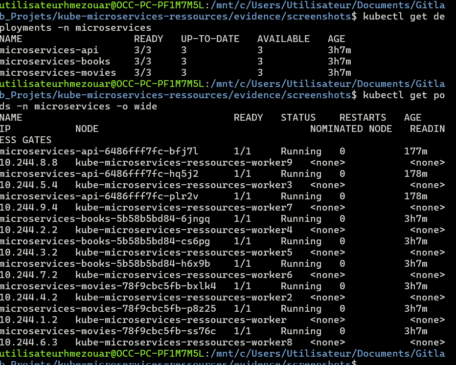
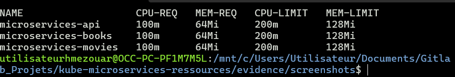
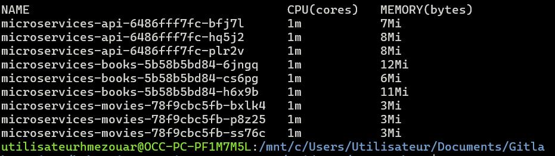
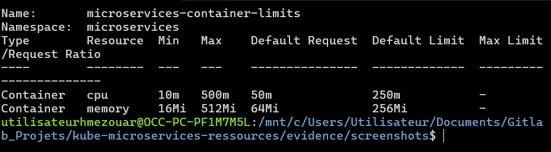
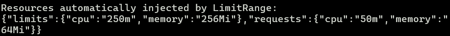
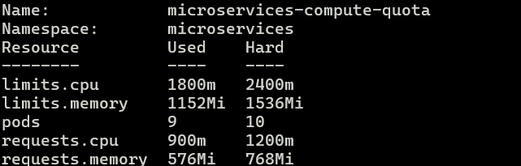
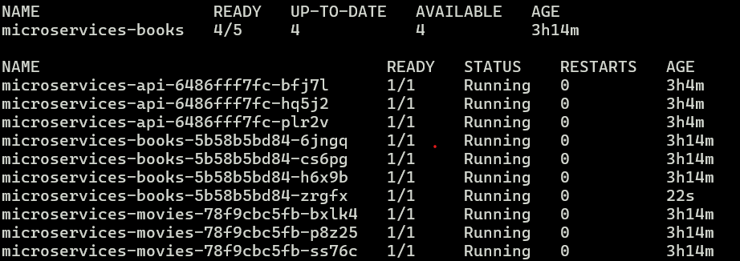
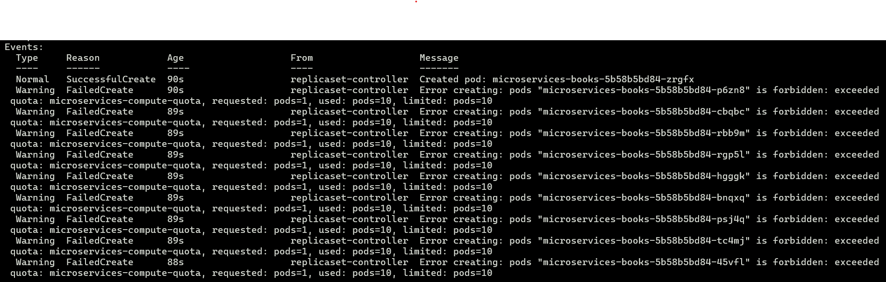
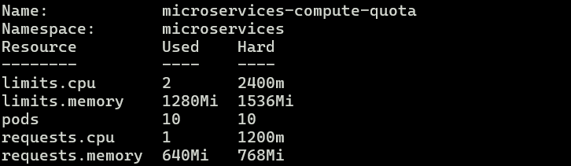
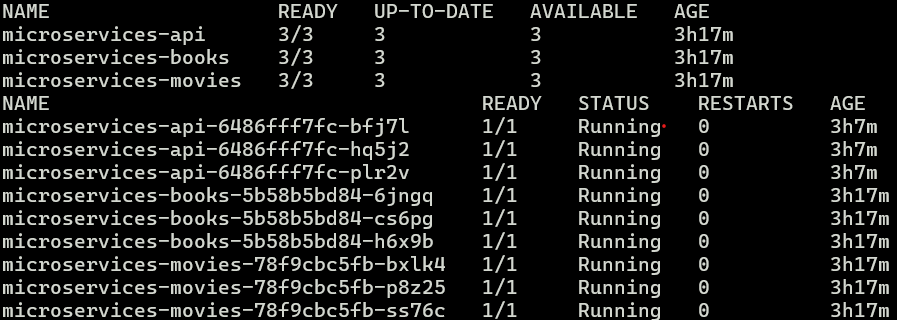

# Kubernetes Resource Management — Test Evidence

## 1. Application running

The three microservices are deployed with three replicas each. All application
Pods are running.

## 2. CPU and memory requests and limits

Each application container requests `100m` CPU and `64Mi` memory. Each
container is limited to `200m` CPU and `128Mi` memory.

## 3. Current CPU and memory usage

Metrics-server exposes the current CPU and memory consumption of the
application Pods.

## 4. LimitRange configuration

The `microservices-container-limits` LimitRange defines default, minimum, and
maximum CPU and memory values for containers in the namespace.

## 5. LimitRange default injection

A temporary Pod was created without an explicit `resources` configuration.
Kubernetes automatically injected the default requests and limits defined by
the LimitRange.

## 6. ResourceQuota before the scaling test

The application normally runs nine Pods. Its CPU and memory consumption fits
inside the namespace ResourceQuota.

## 7. Deployment unable to reach the requested replica count

The Books Deployment was scaled from three to five replicas. The Deployment
could not reach the requested number because the namespace reached its quota.

## 8. ResourceQuota enforcement

The ReplicaSet generated a `FailedCreate` event containing `exceeded quota`.
This proves that Kubernetes rejected the additional Pod.

> A Pod rejected by ResourceQuota is normally rejected before the Pod object is
> created. Therefore, the main evidence is the incomplete Deployment and the
> `FailedCreate: exceeded quota` event rather than a literal Pending Pod.

## 9. ResourceQuota at its limit

During the test, the namespace reached its configured hard limit.

## 10. Application restored

After the test, the Books Deployment was restored to three replicas. All three
microservices returned to their normal state.

## Test conclusion

The tests demonstrate that:

- CPU and memory requests and limits are applied to all microservices;
- metrics-server reports actual resource usage;
- LimitRange injects default resources and enforces accepted values;
- ResourceQuota limits total namespace consumption;
- excessive Pod creation is rejected with an `exceeded quota` error;
- the application continues to work after the tests.
